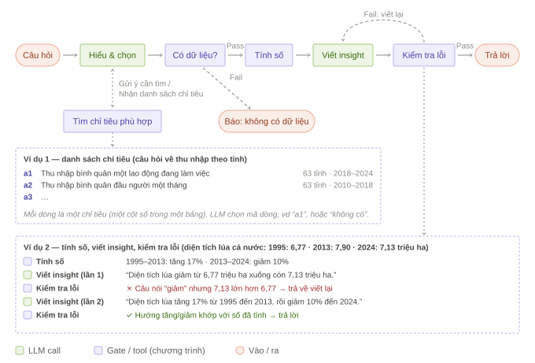
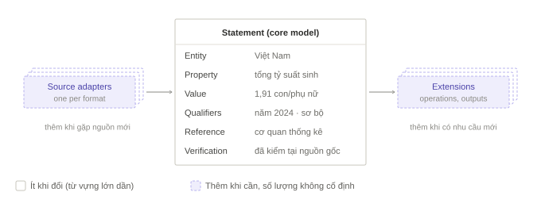

# Từ dữ liệu sẵn có đến nhu cầu thực: Đặt lại bài toán dữ liệu của tòa soạn

*Bản thảo chỉnh sửa, tháng 10/2026*

## Tóm tắt

Khi xây dựng hệ thống dữ liệu cho tòa soạn, điểm xuất phát thường là những gì đang có: các bảng thống kê, kho tài liệu hoặc một chatbot có thể trả lời câu hỏi. Cách tiếp cận này có thể giúp khai thác dữ liệu nhanh hơn, nhưng cũng có nguy cơ tạo ra một hệ thống phù hợp với nguồn dữ liệu sẵn có mà chưa đáp ứng đúng nhu cầu của người làm báo.

Nhu cầu dữ liệu trong tòa soạn không chỉ là tìm một con số. Phóng viên còn cần tìm bối cảnh, phát hiện đề tài, kiểm chứng thông tin, theo dõi số liệu mới, làm đồ họa và xây dựng các bộ dữ liệu riêng. Mỗi nhu cầu cần được chuyển thành một tiêu chí cụ thể để lựa chọn và thiết kế giải pháp (Bảng 1). Chẳng hạn, với nhu cầu tra cứu số liệu, hệ thống cần trả về con số kèm nguồn để người dùng kiểm tra. Với nhu cầu so sánh dữ liệu giữa các năm hoặc địa phương, hệ thống cần nhận diện được những thay đổi về đơn vị hành chính, định nghĩa chỉ tiêu và phạm vi thống kê. Các tiêu chí này giúp xác định hệ thống cần có những chức năng gì và làm cơ sở đánh giá sau khi triển khai.

Bài viết kết hợp tổng quan một số hướng tiếp cận trong tích hợp dữ liệu với những quan sát từ quá trình thử nghiệm một hệ thống hỏi đáp bằng dữ liệu. Từ đó, bài viết đề xuất một nghiên cứu nhu cầu ở mức tối thiểu, có thể do một người thực hiện trong vài tuần: phỏng vấn người làm báo ở các vai trò khác nhau, đếm số liệu trong bài đã đăng, và kiểm kê các nguồn dữ liệu tòa soạn đang có. Kết quả nghiên cứu sẽ được dùng để lựa chọn giữa việc kết nối nguồn dữ liệu có sẵn, xây dựng công cụ hỗ trợ truy xuất và trả lời, hay đầu tư thu thập dữ liệu mới.

Bài viết cũng thảo luận một số nguyên tắc thiết kế hệ thống có sử dụng mô hình ngôn ngữ lớn (LLM), trong đó nhấn mạnh việc để chương trình (tool) thực hiện tính toán, kiểm soát phạm vi câu trả lời, truy xuất nguồn và công khai những giới hạn chưa giải quyết được. Đây là khung nghiên cứu và định hướng thiết kế cần được kiểm chứng thêm, chưa phải một phương pháp đã được xác nhận cho mọi loại dữ liệu và mọi tòa soạn.

## Thuật ngữ

| Thuật ngữ | Nghĩa trong bài |
| --- | --- |
| **LLM** (large language model, mô hình ngôn ngữ lớn) | Mô hình như GPT, Claude, Gemini: đọc và viết văn bản, có thể hiểu câu hỏi tự nhiên, nhưng có thể viết ra thông tin không có trong dữ liệu |
| **Workflow** | Quy trình trong đó các bước gọi LLM và các bước do chương trình thực hiện được sắp sẵn theo thứ tự cố định, thay vì để LLM tự quyết bước tiếp theo [9] |
| **Chỉ tiêu** | Một đại lượng được đo, ví dụ "thu nhập bình quân một lao động". Trong dữ liệu, chỉ tiêu thường là một cột số của một bảng; một bộ dữ liệu (dataset) có thể chứa nhiều chỉ tiêu |
| **Chương trình** | Code do người viết sẵn, chạy giống nhau mọi lần: cùng đầu vào luôn cho cùng kết quả, kiểm tra lại được. Tool và gate đều là chương trình |
| **Tool** | Chương trình làm một việc rồi trả kết quả, ví dụ tìm các chỉ tiêu phù hợp với câu hỏi, hay tính mức tăng giảm. Có thể hình dung tool là "người làm" |
| **Gate** | Chương trình kiểm tra đặt giữa các bước của workflow, chỉ trả lời đạt hoặc không đạt; không đạt thì bị chặn lại hoặc trả về làm lại [9]. Có thể hình dung gate là "người duyệt" |
| **Nguồn phát hành gốc** / **nguồn trung gian** | Nơi công bố con số lần đầu (cơ quan thống kê, doanh nghiệp, văn bản pháp luật) / nơi trích lại con số (bài báo, hãng tin) |
| **Truy xuất nguồn** (provenance) | Khả năng lần từ một con số về đúng tài liệu, vị trí và thời điểm công bố |
| **Tích hợp dữ liệu** (data integration) | Đưa dữ liệu từ nhiều nguồn về một cách nhìn thống nhất để truy vấn và so sánh [2] |
| **Phạm vi trả lời** | Phần câu trả lời nói rõ hệ thống đã trả lời được gì, chưa trả lời được gì, thiếu dữ liệu gì |

## 1. Tòa soạn thực sự cần gì từ dữ liệu?

Một phóng viên đang viết bài có thể cần tìm một con số về tăng trưởng kinh tế. Nhưng một đồng nghiệp khác có thể cần so sánh con số đó với năm trước, tìm nguyên nhân của một biến động, kiểm tra phát biểu của một quan chức hoặc phát hiện một xu hướng đáng chú ý trong nhiều năm.

Những nhu cầu này có liên quan nhưng không giống nhau. Một hệ thống chỉ làm tốt việc tìm số liệu chưa chắc giúp phóng viên phát hiện đề tài. Một kho dữ liệu có nhiều bảng chưa chắc giúp người dùng biết bảng nào phù hợp với câu hỏi. Và một chatbot trả lời nhanh chưa chắc cung cấp được con số có nguồn gốc rõ ràng.

Bảng 1 đưa ra một cách phân loại sơ bộ các nhu cầu dữ liệu trong tòa soạn, kèm tiêu chí ban đầu để đánh giá một giải pháp có đáp ứng nhu cầu đó hay không. Đây là khung giả thuyết để bắt đầu nghiên cứu, không phải một hệ phân loại đã được kiểm chứng.

**Bảng 1. Các dạng nhu cầu dữ liệu trong tòa soạn**

| Nhu cầu | Tình huống thường gặp | Kết quả mong muốn | Tiêu chí đánh giá ban đầu |
| --- | --- | --- | --- |
| Tra cứu số liệu | Phóng viên cần một con số để viết bài | Con số kèm nguồn | Con số đúng định nghĩa, thời gian, phạm vi; người dùng mở được nguồn để kiểm tra |
| Tìm bối cảnh | Cần hiểu một sự kiện trong tương quan với quá khứ hoặc địa phương khác | Bảng so sánh, xu hướng | Các giá trị so sánh được với nhau: cùng định nghĩa, đơn vị, phạm vi; nhận diện thay đổi đơn vị hành chính |
| Phát hiện đề tài | Phóng viên hoặc ban dữ liệu muốn tìm điều đáng chú ý trong số liệu | Gợi ý đề tài, góc tiếp cận | Gợi ý đúng với dữ liệu, không hiển nhiên, kèm cách kiểm tra lại |
| Kiểm chứng thông tin | Một phát ngôn hoặc thông cáo đưa ra con số cụ thể | Kết quả đối chiếu, kèm điều kiện và nguồn | Nêu rõ khớp, lệch hay thiếu điều kiện; dẫn tới nguồn đối chiếu |
| Theo dõi và cảnh báo | Một chỉ tiêu mới được công bố hoặc có biến động | Thông báo, gợi ý bài viết | Độ trễ từ lúc nguồn công bố; tỷ lệ cảnh báo có ích |
| Làm đồ họa | Ban đồ họa cần dữ liệu để vẽ biểu đồ hoặc bản đồ | Dữ liệu đúng cấu trúc, đơn vị và phạm vi | Dữ liệu và ranh giới bản đồ cùng phạm vi, cùng thời điểm |
| Thu thập dữ liệu riêng | Tòa soạn cần theo dõi một nhóm thông tin chưa có sẵn dưới dạng dữ liệu dùng được | Bộ dữ liệu do tòa soạn xây dựng và duy trì | Công sức cập nhật; mức độ được tái sử dụng |
| Xây công cụ cho độc giả | Độc giả muốn tra cứu thông tin theo nhu cầu riêng | Công cụ hoặc sản phẩm tra cứu | Độ chính xác, lượt sử dụng, công sức duy trì |
| Giữ nhất quán giữa các bài | Biên tập viên cần kiểm tra một con số đã được sử dụng trước đó | Số liệu đã đăng, nguồn và thời điểm sử dụng | Tìm được con số đã đăng cùng nguồn và thời điểm |

Các nhu cầu này có thể chồng lấn. Một bộ dữ liệu được thu thập riêng có thể vừa phục vụ phát hiện đề tài, vừa dùng để làm đồ họa và xây công cụ cho độc giả. Vì vậy, bảng trên nên được xem là bản đồ ban đầu để tìm hiểu công việc của tòa soạn, thay vì những nhóm tách biệt hoàn toàn.

### 1.1. Cách đo quyết định nhu cầu nào được nhìn thấy

Một khó khăn quan trọng là những nhu cầu chưa được đáp ứng thường khó quan sát hơn những nhu cầu đã tạo ra sản phẩm.

Chẳng hạn, đếm số liệu xuất hiện trong các bài đã đăng có thể cho biết phóng viên thường sử dụng loại số liệu nào. Nhưng cách này không cho biết có bao nhiêu đề tài đã bị bỏ vì không tìm được dữ liệu, bao nhiêu lần phóng viên không kịp theo dõi một biến động, hoặc bao nhiêu công cụ tra cứu đáng lẽ có thể được xây dựng nhưng chưa từng được đề xuất.

Nghiên cứu của Kasica, Berret và Munzner (2023) về công việc xử lý dữ liệu trong báo chí và khoa học dữ liệu ghi nhận rằng dữ liệu bẩn, quá phức tạp hoặc thiếu độ tin cậy có thể khiến người làm báo từ bỏ dự án [1]. Đây là một ví dụ về khó khăn không nhất thiết thể hiện qua những gì xuất hiện trên mặt báo.

Vì vậy, không nên dùng một chỉ báo duy nhất để đại diện cho toàn bộ nhu cầu dữ liệu. Nếu chỉ đếm số liệu trong bài đã đăng, nghiên cứu sẽ chủ yếu nhìn thấy những nhu cầu đã được đáp ứng. Nếu chỉ phỏng vấn, kết quả có thể phản ánh trải nghiệm và cách nhớ lại của người được hỏi. Nếu chỉ khảo sát mức độ quan tâm, câu trả lời chưa chắc phản ánh tần suất sử dụng hay công sức thực tế.

**Muốn biết tòa soạn cần gì, trước hết phải tìm hiểu công việc mà người làm báo đang cố gắng hoàn thành, kể cả những lần họ không hoàn thành được công việc đó.**

## 2. Vì sao cung cấp dữ liệu cho tòa soạn không đơn giản?

Những nhu cầu trên khác nhau về mục đích, nhưng cùng gặp một số khó khăn khi dữ liệu được lấy từ nhiều nguồn.

### 2.1. Dữ liệu nằm ở nhiều nơi và nhiều định dạng

Số liệu có thể nằm trong báo cáo PDF, bảng tính, trang web, thông cáo báo chí, văn bản pháp luật hoặc cơ sở dữ liệu trực tuyến. Những thông tin khác có thể tồn tại dưới dạng danh sách địa điểm, dữ liệu bản đồ hoặc các bản ghi được thu thập theo thời gian.

Không phải nguồn nào cũng có cấu trúc thuận tiện để phần mềm đọc và tính toán. Một bảng được trình bày đẹp để in có thể có nhiều tầng tiêu đề, ô gộp, đơn vị nằm trong tên cột hoặc phạm vi thời gian không được ghi rõ. Người đọc có thể hiểu bảng sau khi xem xét cẩn thận, nhưng việc chuyển bảng thành dữ liệu có thể tìm kiếm và tính toán lại là một công việc khác.

### 2.2. Cùng một đối tượng có thể có nhiều tên gọi

Một chỉ tiêu có thể được gọi theo nhiều cách. Một địa phương có thể có tên viết tắt hoặc tên thay đổi theo thời gian. Doanh nghiệp có thể xuất hiện dưới tên đầy đủ, tên giao dịch hoặc mã chứng khoán.

Nếu hệ thống chỉ dựa vào việc so khớp tên gọi, nó có thể bỏ sót thông tin liên quan hoặc nhầm hai đối tượng khác nhau. Ngược lại, hai cách viết khác nhau đôi khi lại chỉ cùng một đối tượng.

Giải quyết vấn đề này không chỉ là chuẩn hóa văn bản. Hệ thống cần biết khi nào hai tên gọi có thể được xem là tương đương và khi nào phải giữ chúng thành những đối tượng riêng biệt.

### 2.3. Với một số loại dữ liệu, nghĩa và độ tin cậy của con số phụ thuộc điều kiện đi kèm

Không phải dữ liệu nào cũng có vấn đề này, nhưng khi có thì dễ dẫn tới sai sót khó nhận ra. Với một số chỉ tiêu, cùng một tên gọi có thể có số sơ bộ và số chính thức, số kế hoạch và số thực hiện, hoặc số liệu tại một thời điểm và số liệu lũy kế. Hai bảng cùng ghi số dân theo tỉnh cũng chưa chắc so sánh trực tiếp được nếu khác năm thống kê hoặc phạm vi địa lý. Bỏ qua những điều kiện này, hệ thống có thể trả về một con số đúng về mặt số học nhưng sai với câu hỏi.

Một số con số mới công bố cũng chỉ có một nguồn. Khi cần kiểm chứng, hệ thống có thể kiểm tra con số có được trích đúng từ tài liệu không, phép tính có nhất quán không và nguồn có phải nơi phát hành gốc không, nhưng không tự chứng minh được con số phản ánh đúng thực tế. Mức kiểm tra cần thiết tùy mục đích sử dụng: tra một con số quen thuộc khác với kiểm chứng một phát ngôn.

### 2.4. Nhu cầu có thể xuất hiện trước khi dữ liệu được chuẩn bị

Khi có một sự kiện, phóng viên có thể cần số liệu ngay trong ngày. Nhưng dữ liệu phù hợp có thể chưa được thu thập, chuẩn hóa hoặc đối chiếu.

Điều này tạo ra một bài toán về thời gian và nguồn lực. Chuẩn bị trước mọi loại dữ liệu có thể tốn kém và không cần thiết. Ngược lại, chỉ xử lý khi có yêu cầu có thể khiến tòa soạn không kịp đáp ứng những nhu cầu cần phản ứng nhanh.

Các khó khăn này không có nghĩa một phương pháp tích hợp dữ liệu cụ thể sẽ thất bại. Chúng cho thấy cần xác định rõ loại nhu cầu, mức độ tin cậy cần thiết và thời gian đáp ứng trước khi quyết định cách tổ chức hệ thống.

## 3. Các hướng tiếp cận hiện có giải quyết được phần nào của bài toán?

Tích hợp dữ liệu là lĩnh vực nghiên cứu lâu đời, tập trung vào việc kết hợp dữ liệu từ nhiều nguồn để người dùng có thể truy vấn và sử dụng theo một cách thống nhất [2]. Những công trình về kho dữ liệu, tích hợp dần theo nhu cầu và đồ thị tri thức cũng cung cấp các cách tiếp cận khác nhau cho vấn đề này [3–5].

Tuy nhiên, một giải pháp phù hợp với tòa soạn không chỉ cần xử lý dữ liệu. Nó còn phải cân đối giữa công sức chuẩn bị, thời gian đáp ứng, độ tin cậy của kết quả và nguồn lực vận hành.

Bảng 2 tóm tắt một số hướng tiếp cận cùng những câu hỏi cần xem xét khi áp dụng vào tòa soạn.

**Bảng 2. Các hướng tiếp cận trong tổ chức và khai thác dữ liệu**

| Hướng tiếp cận | Giá trị chính | Vấn đề cần xem xét trong bối cảnh tòa soạn |
| --- | --- | --- |
| Thiết kế kho dữ liệu trước (data warehouse) | Dữ liệu được tổ chức theo cấu trúc xác định, thuận tiện cho truy vấn và phân tích | Cần xác định nguồn dữ liệu và cấu trúc nào đáng đầu tư chuẩn hóa trước |
| Lưu dữ liệu nguyên trạng, tích hợp dần khi cần (data lake [7]; trong nghiên cứu gọi là dataspaces, tích hợp "pay-as-you-go" [3]) | Có thể khai thác các nguồn hiện có ngay và tăng dần mức độ tích hợp | Nhu cầu mới có thể xuất hiện trước khi dữ liệu được tích hợp đầy đủ |
| Xây dựng đồ thị tri thức và hợp nhất dữ kiện từ nhiều nguồn (knowledge graph, ví dụ Wikidata [8]; Knowledge Vault [4], ODKE+ [5]) | Kết nối thông tin giữa các nguồn, hỗ trợ nhận diện đối tượng và đối chiếu dữ kiện | Cần xử lý tên gọi khác nhau, điều kiện dữ liệu và trường hợp chỉ có một nguồn |
| Áp dụng chuẩn dữ liệu thống kê (SDMX\*) | Thống nhất cách mô tả, trao đổi và so sánh dữ liệu thống kê | Không phải nguồn dữ liệu phóng viên cần đều tuân theo chuẩn có sẵn |
| Dùng LLM để khai thác dữ liệu (RAG — LLM đọc tài liệu rồi trả lời; text-to-SQL — LLM viết câu truy vấn cơ sở dữ liệu [6]) | Hỗ trợ tìm kiếm tài liệu hoặc truy vấn dữ liệu bằng ngôn ngữ tự nhiên | Cần kiểm soát việc chọn sai dữ liệu, bỏ điều kiện và trả lời không chính xác |

\* Tên chuẩn phổ biến trong thực hành thống kê; bài viết chưa dẫn tài liệu cụ thể. Data warehouse và data lake cũng có nhiều định nghĩa khác nhau trong thực hành; bảng dùng nghĩa thông dụng nhất.

Các hướng tiếp cận trên giải quyết những phần khác nhau của bài toán. Data warehouse tập trung vào việc tổ chức dữ liệu để phục vụ các nhu cầu đã xác định. Data lake và dataspaces nhấn mạnh khả năng khai thác các nguồn hiện có và tích hợp dần theo nhu cầu. Knowledge graph tập trung vào việc kết nối thông tin giữa các nguồn. Trong khi đó, RAG và Text-to-SQL giúp người dùng tìm kiếm hoặc truy vấn dữ liệu bằng ngôn ngữ tự nhiên.

Mỗi hướng giải tốt một phần của bài toán. Trong các tài liệu đã xem, chưa thấy hướng nào đáp ứng đồng thời các đặc điểm ở mục 2: nguồn đa dạng về định dạng, đối tượng có nhiều tên gọi, nhu cầu xuất hiện trước khi dữ liệu được chuẩn bị, và, với một số loại dữ liệu, con số phụ thuộc điều kiện hoặc chỉ có một nguồn.

Những hướng tiếp cận này không nhất thiết loại trừ lẫn nhau. Một hệ thống có thể sử dụng kho dữ liệu đã chuẩn hóa cho các chỉ tiêu thường xuyên, kết hợp với công cụ truy xuất tài liệu cho những nguồn chưa được cấu trúc. Câu hỏi cần giải quyết không phải là chọn một phương pháp duy nhất, mà là xác định phần nào của bài toán đã có giải pháp phù hợp, phần nào cần kết hợp nhiều phương pháp và phần nào cần đầu tư thêm.

Trong bối cảnh tòa soạn, quyết định này cần dựa trên nhu cầu sử dụng, công sức xử lý hiện tại, yêu cầu về độ tin cậy và lợi ích kỳ vọng, thay vì chỉ dựa trên số lượng dữ liệu đang có. Không phải bộ dữ liệu nào đang có cũng đáng để tích hợp trước; ngược lại, một nguồn ít được sử dụng nhưng quan trọng với các bài điều tra hoặc quyết định biên tập vẫn có thể cần được ưu tiên.

## 4. Những rủi ro khi dùng LLM để trả lời bằng dữ liệu

LLM giúp phóng viên hỏi bằng câu thường thay vì phải biết bảng nào, cột nào. Nhưng khi câu trả lời là một con số, LLM mang theo những rủi ro riêng. Dưới đây là bốn rủi ro gặp trong quá trình thử xây một hệ thống hỏi đáp bằng dữ liệu, mỗi rủi ro kèm một ví dụ và cách giảm.

### 4.1. Số đúng, câu sai

LLM có thể nhận đúng các con số mà vẫn viết sai ý.

> **Ví dụ.** Đưa cho LLM ba con số về diện tích lúa cả nước: năm 1995 là 6,77 triệu ha, năm 2013 là 7,90 triệu ha, năm 2024 là 7,13 triệu ha, rồi nhờ viết một câu. LLM viết: "diện tích lúa giảm từ 6,77 triệu ha xuống còn 7,13 triệu ha". Con số nào cũng đúng, nhưng 7,13 lớn hơn 6,77. Một lần khác, LLM gọi một giá trị là "thấp nhất" trong khi nó chỉ bằng mức của mấy năm trước.

**Cách giảm:** để một tool tính trước những ý cần nói ("1995–2013 tăng 17%; 2013–2024 giảm 10%", "bằng mức năm 2020", "cao nhất kể từ…"). LLM chỉ viết câu nối quanh các ý đã có. Một gate kiểm lại câu trước khi đưa ra, ví dụ câu đặt hai con số cạnh chữ "giảm" trong khi số sau lớn hơn thì bị trả về viết lại.

### 4.2. Tự điền thông tin không có trong dữ liệu

Khi thiếu thông tin, LLM có xu hướng tự lấp chỗ trống bằng điều nghe hợp lý.

> **Ví dụ.** Phóng viên hỏi: "Tỷ lệ tử vong do ung thư ở các tỉnh có liên quan đến tuổi thọ trung bình không?" Tìm theo chữ trong kho sẽ ra những chỉ tiêu gần chữ: số trường hợp đăng ký khai tử, số người nhiễm HIV/AIDS, tỷ suất chết của trẻ dưới một tuổi. Không cái nào là tử vong do ung thư. Nếu để LLM tự do, nó có thể dùng một trong số đó và trả lời như thể đã có dữ liệu. Ở một lần khác, LLM được nhờ mô tả một chuỗi số liệu mức sinh và viết "trước năm 2020, mức sinh chủ yếu đi lên", trong khi số liệu chỉ dao động quanh 2,0–2,1 con/phụ nữ.

**Cách giảm:** chỉ cho LLM *chọn* trong một danh sách chỉ tiêu có định nghĩa rõ, kèm lựa chọn "không có cái nào đúng"; không để LLM tự mô tả điều mà dữ liệu chưa được tính sẵn. Danh sách vẫn có thể thiếu phương án đúng, nên cần kiểm cả chất lượng danh sách.

### 4.3. Trả lời lệch đề mà không báo

Một câu trả lời trôi chảy có thể không trả lời đúng điều được hỏi, và người đọc khó nhận ra.

> **Ví dụ.** Phóng viên hỏi: "Nghệ An đang tụt lại hay tiến lên về tỷ lệ hộ nghèo so với các tỉnh Bắc Trung Bộ?" Hệ thống trả về một đoạn về xu hướng hộ nghèo **cả nước**, không nhắc tới Nghệ An. Đọc lướt, người dùng dễ tưởng câu hỏi đã được trả lời.

**Cách giảm:** mỗi câu trả lời có phần **phạm vi trả lời** do chương trình viết (không do LLM), nói rõ ba điều: phần nào đã trả lời, phần nào chưa làm được (ở ví dụ trên: so sánh riêng Nghệ An với vùng), phần nào không có dữ liệu trong các nguồn đã kết nối. "Không có dữ liệu" chỉ nói về các nguồn đã kết nối, không có nghĩa thông tin không tồn tại. Với những con số cần kiểm chứng (mục 2.3), câu trả lời cũng nên ghi mức xác minh: đã kiểm tại nơi phát hành gốc, chỉ có nguồn trung gian, hay chỉ có một nguồn.

### 4.4. Sửa lỗi theo tên gọi thì gãy khi gặp nguồn mới

Cách sửa lỗi nhanh nhất thường là thêm một quy tắc dựa trên tên gọi. Quy tắc đó đúng với dữ liệu đang thử, nhưng sai khi gặp dữ liệu khác.

> **Ví dụ.** Một quy tắc nhận tên địa phương bằng cách bỏ dấu rồi so chữ. Với câu "ô nhiễm không khí *diễn biến* thế nào", quy tắc nhận "diễn biến" thành tỉnh **Điện Biên**. Một quy tắc khác ghép hai bảng có cột cùng tên "Tổng số"; kết quả là số vụ ly hôn bị ghép với một chỉ tiêu dân số, và câu trả lời nói số vụ ly hôn "giảm đều" trong khi thực tế năm cuối cao nhất.

**Cách giảm:** để chính dữ liệu phân xử thay vì tên gọi. Ví dụ, chỉ coi hai chuỗi số là cùng chỉ tiêu khi các năm trùng nhau có giá trị khớp nhau. Luôn thử hệ thống trên những nguồn và câu hỏi chưa dùng khi thiết kế.

### 4.5. Cách giảm chung

Bốn cách giảm trên dẫn tới cùng một cách tổ chức, theo mẫu workflow mà Anthropic mô tả khi xây hệ thống dùng LLM [9] (Hình 1): LLM hiểu câu hỏi, chọn dữ liệu trong danh sách có sẵn và viết câu nối; tool tra cứu và tính toán; gate kiểm tra trước khi đi tiếp.

*Hình 1. Workflow trả lời một câu hỏi bằng dữ liệu, vẽ theo quy ước của Anthropic [9]: ô xanh là LLM call, ô tím là gate hoặc tool do chương trình thực hiện, nét đứt là nhánh không đạt (Fail). Ví dụ 1: LLM chỉ chọn trong danh sách chỉ tiêu do tool "Tìm chỉ tiêu phù hợp" trả về (giảm rủi ro 4.2, 4.4); gate "Có dữ liệu?" dừng lại và báo thiếu dữ liệu thay vì trả lời lệch đề (4.3). Ví dụ 2: tool "Tính số" tính trước hướng và mức thay đổi; LLM viết insight dựa trên đó; gate "Kiểm tra lỗi" bắt câu nói sai hướng và trả về viết lại (4.1).*

*Ghi chú về bằng chứng.* Các ví dụ trên đến từ thử nghiệm nội bộ trên một kho vài trăm bộ dữ liệu, chủ yếu là bảng thống kê, với hai bộ câu hỏi nhỏ thuộc nhiều lĩnh vực. Sau khi áp dụng các cách giảm, lỗi trả lời lệch đề không báo và lỗi câu sai ý không còn xuất hiện trong bộ câu hỏi thứ hai. Đây là tín hiệu ban đầu trên quy mô nhỏ, chưa phải kết quả đã kiểm chứng rộng.

## 5. Đề xuất: nghiên cứu nhu cầu trước, rồi mới chọn giải pháp

### 5.1. Nghiên cứu nhu cầu ở mức tối thiểu

Mục tiêu là có một **bản đồ nhu cầu** đủ để quyết định làm gì trước, với nguồn lực nhỏ. Bốn việc dưới đây có thể do một người thực hiện trong khoảng năm đến sáu tuần.

| Việc | Cách làm | Thời gian | Đầu ra |
| --- | --- | --- | --- |
| 1. Phỏng vấn | 10–15 người: mỗi ban 1–2 phóng viên hoặc biên tập viên, cộng ban dữ liệu, đồ họa và sản phẩm. Mỗi buổi 30–45 phút, dùng chung bộ câu hỏi bên dưới | 2–3 tuần | Danh sách nhu cầu thực tế; 10–20 tình huống cụ thể (cần gì, tìm ở đâu, mất bao lâu, có tìm được không) |
| 2. Đếm số liệu trong bài đã đăng | Lấy một mẫu bài của mọi ban, dùng quy trình tự động trích các con số và xếp nhóm | 1 tuần | Nhóm số liệu nào được dùng nhiều ở từng ban |
| 3. Kiểm kê nguồn đang có | Hỏi trưởng các ban: tòa soạn đang mua hoặc dùng nguồn dữ liệu nào, các ban tự duy trì bảng tính nào | 1 tuần, làm song song | Nhu cầu nào đã có nguồn sạch |
| 4. Gộp thành bản đồ nhu cầu | Mỗi nhu cầu ghi: dùng nhiều hay ít, tốn công nhiều hay ít (từ phỏng vấn), đã có nguồn chưa; xếp vào một trong ba trường hợp ở mục 5.2 | vài ngày | Bản đồ nhu cầu một trang, kèm đề xuất làm gì trước |

Bộ câu hỏi phỏng vấn:

* Lần gần nhất anh/chị phải tìm một con số hoặc bộ dữ liệu là khi nào? Để làm gì?
* Anh/chị đã tìm ở đâu, mất bao lâu, phải xử lý những bước nào?
* Có lúc nào tìm được nhưng không chắc dữ liệu đúng với câu hỏi không?
* Có bài hay dự án nào bị chậm hoặc bỏ vì không tìm được dữ liệu không?
* Anh/chị có tự giữ bảng theo dõi nào mà đồng nghiệp có thể cũng đang làm riêng không?
* Nếu được cải thiện một bước trong việc tìm và dùng dữ liệu, bước nào giúp nhiều nhất?

Việc 2 đã có quy trình chạy thử: trên hơn 14.000 bài của một ban, quy trình trích được hơn 140.000 con số, và 99,85% trong số đó có thật trong bài gốc. Kết quả của một ban chỉ cho thấy quy trình chạy được, không đại diện cho nhu cầu của toàn tòa soạn.

Những việc **không** nằm trong bản tối thiểu, có thể làm sau nếu bản đồ nhu cầu cho thấy cần: đo có hệ thống các dự án bị bỏ và các lần đính chính; ghi nhật ký thời gian tìm dữ liệu trong nhiều tuần; khảo sát độc giả về công cụ tra cứu.

### 5.2. Chọn cách xử lý theo tình trạng nguồn

Mỗi nhu cầu trong bản đồ rơi vào một trong ba trường hợp:

| Tình trạng nguồn | Cách xử lý |
| --- | --- |
| Đã có nguồn dữ liệu sạch và phù hợp | Kết nối nguồn, làm lớp hỏi đáp có ghi nguồn |
| Có nơi phát hành gốc nhưng dữ liệu khó dùng trực tiếp (thông cáo, báo cáo, văn bản) | Xây quy trình đọc, trích xuất và kiểm tra cho nguồn đó |
| Chưa có nguồn phù hợp | Cân nhắc tự thu thập, hợp tác với đơn vị cung cấp, hoặc nói rõ là chưa đáp ứng được |

Trước khi xây hệ thống cho một nhu cầu, cần so với các phương án đơn giản hơn: mua hoặc kết nối một nguồn có sẵn, thống nhất cách ghi nguồn, chia sẻ bảng tính giữa các ban, hoặc giao một người làm đầu mối dữ liệu. Chỉ xây khi các phương án đó không đủ.

### 5.3. Định hướng kiến trúc

Nếu bản đồ nhu cầu cho thấy cần một hệ thống, hướng thiết kế gợi ý gồm ba phần:

* **Một cấu trúc chung cho mọi thông tin:** đối tượng, thuộc tính, giá trị, điều kiện và nguồn. Đây là cách các knowledge graph lớn như Wikidata tổ chức tri thức cho mọi lĩnh vực [8]. Cấu trúc nền ít khi đổi; gặp định dạng nguồn mới thì thêm một bộ đọc, gặp nhu cầu mới thì thêm khái niệm hoặc phép tính (Hình 2). Bảng thống kê, văn bản pháp luật hay dữ liệu bản đồ vẫn có thể cần cách lưu chuyên biệt bên dưới.
* **Một lớp hỏi đáp dùng chung,** theo workflow ở Hình 1: LLM hiểu, chọn và viết; tool tra cứu và tính toán; gate kiểm tra và chương trình ghi phạm vi trả lời.
* **Phần thu thập chỉ cho trường hợp thứ hai ở mục 5.2.** Nếu một nơi phát hành công bố báo cáo theo cùng một mẫu, chỉ cần học cách đọc mẫu đó một lần rồi dùng lại.

*Hình 2. Mỗi thông tin, dù đến từ nguồn nào, được lưu thành một nhận định (statement) cùng cấu trúc; ví dụ trong thẻ là một con số thống kê. Cấu trúc này ít khi đổi, chỉ có từ vựng (loại đối tượng, thuộc tính) lớn dần. Bộ đọc nguồn (source adapters) và phần mở rộng (extensions: phép tính, kiểu đầu ra) được thêm khi cần, số lượng không cố định.*

Chất lượng được giữ bằng hai cách: phóng viên xem được nguồn và báo lỗi ngay khi dùng; định kỳ kiểm tra một mẫu câu trả lời theo ngưỡng chấp nhận, như các hệ thống trích xuất tri thức quy mô lớn đang làm [5].

## 6. Đo thành công

Cách đo đơn giản nhất và làm được ngay sau nghiên cứu nhu cầu:

1. Lấy **20–30 câu hỏi thật** thu được từ phỏng vấn ở mục 5.1, trải đều các nhu cầu và các ban. Không dùng câu hỏi do người xây hệ thống tự đặt.
2. Đưa từng câu vào hệ thống, hoặc vào phương án thay thế (ví dụ một nguồn mua sẵn).
3. Một người chấm mỗi câu theo ba ô:

| Tiêu chí | Đạt khi |
| --- | --- |
| **Đúng** (chỉ số chính) | Con số đúng định nghĩa, thời gian và phạm vi mà câu hỏi cần |
| **Có nguồn** | Mở được tài liệu gốc chứa con số |
| **Trung thực về giới hạn** | Phần chưa trả lời được hoặc không có dữ liệu được nói rõ, không bị thay bằng số khác |

Chỉ số chính là **tỷ lệ câu hỏi đạt cả ba ô**. Kết quả nên tách theo nhu cầu và theo loại nguồn, vì một hệ thống có thể tốt với bảng thống kê nhưng yếu với văn bản. Lặp lại cách đo này sau mỗi lần cải tiến, với một phần câu hỏi được giữ riêng, chưa dùng khi sửa hệ thống.

## 7. Giới hạn và hướng nghiên cứu tiếp theo

Bài viết hiện có ba giới hạn chính.

Thứ nhất, bản đồ nhu cầu ở Bảng 1 là giả thuyết ban đầu, chưa được xác nhận bằng nghiên cứu trên toàn tòa soạn. Những nhóm nhu cầu thực tế có thể khác hoặc chồng lấn với cách phân loại hiện tại.

Thứ hai, các rủi ro và cách giảm trong mục 4 được rút ra từ một hệ thống thử nghiệm với kho dữ liệu chủ yếu là bảng thống kê và các bộ câu hỏi có quy mô nhỏ. Các kết quả được báo cáo cần được đối chiếu với quy mô bộ kiểm, cách chọn câu hỏi, tiêu chí chấm và khả năng tái lập. Chưa có đủ bằng chứng để khẳng định những nguyên tắc thiết kế này sẽ đem lại kết quả tương tự với mọi loại dữ liệu hoặc mọi tòa soạn.

Thứ ba, một số phương án trong mục 5 là đề xuất thiết kế, chưa phải kết quả đánh giá so sánh giữa các giải pháp. Chẳng hạn, việc sử dụng một cấu trúc thông tin chung, lựa chọn dữ liệu theo nhu cầu và kết hợp tool và gate với LLM đều cần được kiểm chứng trong quá trình triển khai.

Bước tiếp theo là thực hiện nghiên cứu nhu cầu tối thiểu ở mục 5.1, sau đó thử nghiệm các phương án giải quyết trên những nhóm nhu cầu được xác định rõ. Việc đánh giá nên so sánh không chỉ độ chính xác mà cả thời gian, công sức kiểm tra, khả năng truy xuất nguồn và chi phí duy trì.

Một câu hỏi quan trọng là liệu cùng một kiến trúc có thực sự phù hợp với các nhu cầu khác nhau hay không. Có thể kết quả nghiên cứu cho thấy tòa soạn cần một nền tảng chung cho một số công việc, nhưng những nhu cầu khác nên được giải quyết bằng quy trình hoặc công cụ chuyên biệt. Đây là kết quả cần được chấp nhận nếu bằng chứng chỉ ra như vậy.

## 8. Kết luận

Xây dựng hệ thống dữ liệu cho tòa soạn không chỉ là bài toán thu thập, lưu trữ hay tìm kiếm dữ liệu. Đó còn là bài toán xác định người làm báo cần dữ liệu để hoàn thành công việc gì, hiện họ đang mất bao nhiêu công sức và đâu là những nhu cầu chưa được đáp ứng.

Các công cụ đo khác nhau sẽ cho thấy những phần khác nhau của nhu cầu. Dữ liệu trong bài đã đăng giúp hiểu những gì đã được sử dụng, nhưng không phản ánh đầy đủ những dự án bị bỏ hoặc những cơ hội chưa được nhận ra. Vì vậy, cần kết hợp phỏng vấn, quan sát công việc và các chỉ báo định lượng phù hợp.

Những thử nghiệm hệ thống hỏi đáp cũng cho thấy việc đưa LLM vào quy trình không loại bỏ nhu cầu kiểm tra dữ liệu. Hệ thống cần để tool thực hiện tính toán, dùng gate để kiểm tra, giữ lại điều kiện và nguồn gốc của thông tin, đồng thời thể hiện rõ phần chưa trả lời được.

Từ đó, bài viết đề xuất một nguyên tắc thực hành: **xác định nhu cầu trước, đo lường công sức và khả năng đáp ứng hiện tại, rồi mới lựa chọn giải pháp.** Có trường hợp cần xây dựng hệ thống mới; cũng có trường hợp chỉ cần kết nối nguồn có sẵn hoặc thay đổi quy trình làm việc.

Mục tiêu không phải xây dựng hệ thống lớn nhất hay tự động hóa nhiều nhất, mà là tìm ra cách phù hợp để giúp người làm báo sử dụng dữ liệu chính xác, có nguồn gốc rõ ràng và ít tốn công hơn. Việc liệu khung nghiên cứu và định hướng thiết kế này có đạt được mục tiêu đó hay không cần được xác nhận bằng nghiên cứu và đánh giá tiếp theo.

## Tài liệu tham khảo

[1] Kasica, S., Berret, C., & Munzner, T. (2023). "Dirty data in the newsroom: Comparing data preparation in journalism and data science." *CHI*.

[2] Lenzerini, M. (2002). "Data integration: A theoretical perspective." *Proceedings of the ACM SIGMOD-SIGACT-SIGART Symposium on Principles of Database Systems (PODS)*, 233–246.

[3] Franklin, M., Halevy, A., & Maier, D. (2005). "From databases to dataspaces: A new abstraction for information management." *SIGMOD Record*, 34(4).

[4] Dong, X. L., et al. (2014). "Knowledge Vault: A web-scale approach to probabilistic knowledge fusion." *Proceedings of the ACM SIGKDD International Conference on Knowledge Discovery and Data Mining (KDD)*.

[5] Khorshidi, S., et al. (2025). "ODKE+: Ontology-guided open-domain knowledge extraction with LLMs." arXiv:2509.04696.

[6] Radhakrishnan, P., et al. (2024). "Knowing when to ask: Bridging large language models and data." arXiv:2409.13741.

[7] Hai, R., Koutras, C., Quix, C., & Jarke, M. (2023). "Data lakes: A survey of functions and systems." *IEEE Transactions on Knowledge and Data Engineering*, 35(12), 12571–12590.

[8] Vrandečić, D., & Krötzsch, M. (2014). "Wikidata: A free collaborative knowledgebase." *Communications of the ACM*, 57(10).

[9] Anthropic (2024). "Building effective agents." Anthropic Engineering. https://www.anthropic.com/engineering/building-effective-agents
